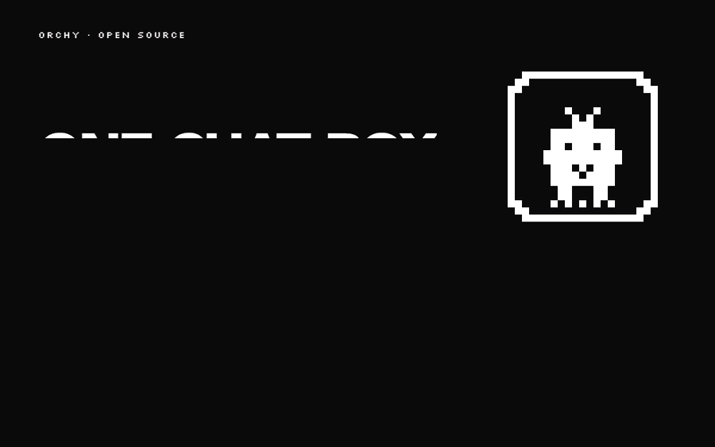
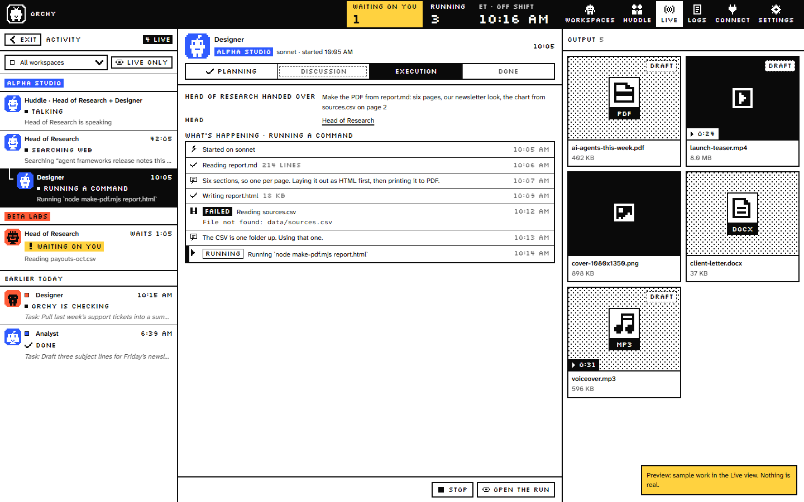
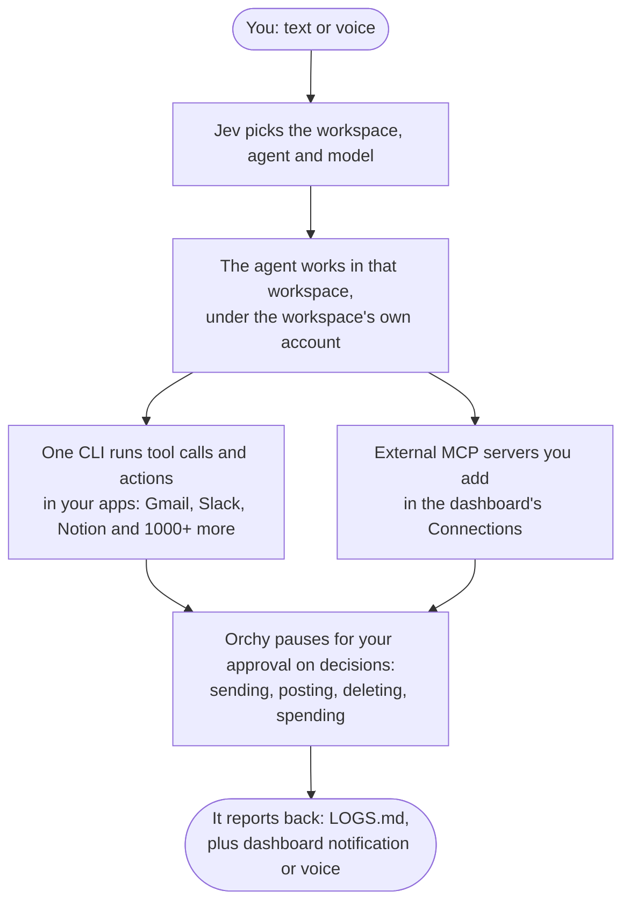
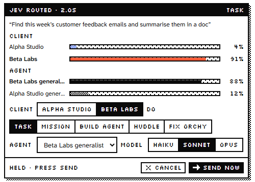
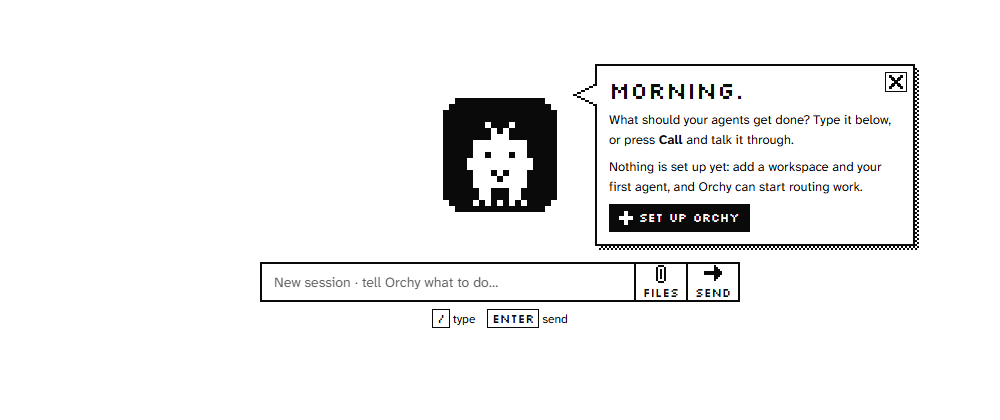
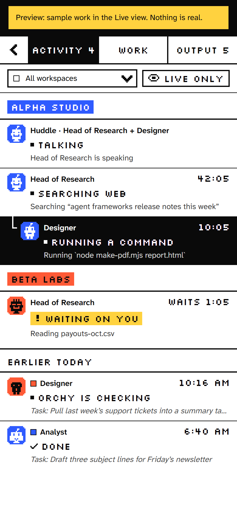

<div align="center">


# Orchy

### Every business owner's best friend.

**Your agents run the business 24/7. You approve every final decision.**

Give each client and department its own workspace. Let routine work run on your computer day and night, while money, emails, calendar invites, and file deletions wait for your green light.

[](LICENSE) [](#quick-start) [](#keys-byok---manage-what-you-spend) [](#security) [](https://nodejs.org) [](#supported-harnesses) [](https://withone.ai) [](docs/CONTRIBUTING.md)

🔌 <a href="https://withone.ai"><b>Orchy now works with One.</b></a> Connect your agents to Gmail, Slack, Notion, Stripe, and 1000+ more apps through the One CLI.

[Quick start](#quick-start) · [How it works](#how-it-works) · [What's in the box](#whats-in-the-box) · [Harnesses](#supported-harnesses) · [Security & Privacy](#what-leaves-your-machine) · [Discussions](https://github.com/janmm97/orchy-ai/discussions) · [Docs](docs/)

</div>

<p align="center">
  
  <br>
  <sub>Real screens from a clean install, using the dashboard's built-in sample data (<code>?preview</code>), shown in Orchy's 1-bit greys. Nothing in them is real and nothing was sent. The title and end cards are illustrations.</sub>
</p>

## You know this evening

You started your company to build great things and serve clients, not to spend your evenings copy-pasting between spreadsheets, answering repetitive tickets, and babysitting broken automations. Dinner is cold, your inbox is overflowing, and you still have three proposals to finish before tomorrow morning.

Autonomous AI should take that weight off your shoulders. But giving an unsupervised agent free rein over your company accounts is a recipe for disaster. One unvetted action can send a broken quote to a VIP client, trigger an accidental refund on Stripe, or wipe out live database records.

Orchy is the best friend every business owner needs. You build agents for marketing, customer support, research, and daily operations. They run 24/7 on your own computer, handling the routine backlog while you sleep or focus on clients. But whenever an agent tries to send an email, charge or refund money, update your calendar, publish content, or delete a file, Orchy pauses and waits for your confirmation in the dashboard.

Your business runs around the clock. The final say always stays with you.

## What's in the box

<table>
<tr>
<td width="50%" valign="top">

### 🎁 100% Free and private
Apache-2.0 open-source software that runs locally on your computer. No monthly platform subscriptions, no credit card required, and no locked tiers. **Orchy does not send anything to its authors.**

<sub>[What leaves your machine →](#what-leaves-your-machine)</sub>

</td>
<td width="50%" valign="top">

### 🧸 User friendly by design
Skip the terminal if you prefer. Double-click the launcher for your system, follow the visual browser setup at `localhost:8008`, and use the AI Agent Builder to assemble your team. Built-in viewers let you inspect PDFs, images, spreadsheets, and video directly in the dashboard.

<sub>[Quick start →](#quick-start)</sub>

</td>
</tr>
<tr>
<td width="50%" valign="top">

### 💳 BYOK: manage what you spend
Bring your own keys and subscriptions. Connect existing Claude or ChatGPT accounts, plug in low-cost API keys (OpenRouter, Groq, DeepSeek), or run free local models with Ollama. You control your budget directly with providers, with zero markup or middleman fees.

<sub>[Keys & spend control →](#keys-byok---manage-what-you-spend)</sub>

</td>
<td width="50%" valign="top">

### ✋ Runs 24/7, asks before it acts
Agents handle routine work day and night. The moment an action touches money, sends an email, publishes a post, changes your calendar, or deletes files, Orchy pauses and waits for your confirmation.

<sub>[Security and approvals →](#security)</sub>

</td>
</tr>
<tr>
<td width="50%" valign="top">

### 🧰 Your squad, your harness
Claude Code (recommended), Codex, Hermes, Antigravity, Cursor, Aider, OpenCode or Custom CLI. Each workspace runs with the sign-in or API keys you choose, held behind the same approval gate.

<sub>[Supported harnesses →](#supported-harnesses)</sub>

</td>
<td width="50%" valign="top">

### 🔌 1000+ real business apps
Gmail, Slack, Notion, Stripe, GitHub and over 1000 more through the [One CLI](https://withone.ai). Every workspace gets its own One login, so one client's inbox never leaks into another's run.

<sub>[Getting started with One →](#getting-started-with-one)</sub>

</td>
</tr>
<tr>
<td colspan="2" valign="top">

### 🗂️ Workspaces that never mix
One dedicated folder per business, client, or department, each with its own logins, agents, and instructions. Orchy checks every run against that workspace's account before starting, refusing the run if credentials mismatch. Agents can also huddle to discuss complex tasks or complete multi-step missions. The Live view shows every run step by step.

<sub>[Core ideas →](#core-ideas)</sub>

</td>
</tr>
</table>

## Quick start

Three lines in a terminal. Shorter than ordering your morning coffee.

```bash
git clone https://github.com/janmm97/orchy-ai
cd orchy-ai
npm run setup
```

Setup checks your environment, installs the One CLI if missing, guides you through choosing your coding harness and router, tests your keys live, starts Orchy, and opens the dashboard in your browser. Keys you paste are hidden as you type, tested once against their service, and saved in `.env` on your computer. All keys are optional.

Pick each workspace's harness (Claude Code, Codex, Hermes, Antigravity, Cursor, Aider, OpenCode, or Custom CLI) in the dashboard when you add the workspace. If the harness is not installed yet, **Install** runs the installer for your computer automatically.

**Prefer not to use a terminal?** Open the `launchers` folder and double-click the launcher for your system: `Start Orchy.cmd` (Windows), `Start Orchy.command` (macOS), or `Start Orchy.sh` (Linux). The launcher runs setup on first launch and starts Orchy every time after that.

<p align="center">
  ⭐ <b>Like it?</b> <a href="https://github.com/janmm97/orchy-ai">Star Orchy</a> so more founders find it. &nbsp;·&nbsp; 🛠️ <b>Want to help?</b> PRs welcome: run <code>npm test</code> first and read <a href="docs/CONTRIBUTING.md">docs/CONTRIBUTING.md</a>. &nbsp;·&nbsp; 💬 <b>Say hi</b> in <a href="https://github.com/janmm97/orchy-ai/discussions">Discussions</a>.
</p>

<details>
<summary><b>What setup asks</b></summary>

1. **Coding CLI:** Choose which harness Orchy coordinates (Claude Code, Codex, Hermes, Antigravity, Cursor, Aider, OpenCode, or Custom CLI). For API-driven engines (Aider, OpenCode, Hermes), setup asks for your router or provider (OpenRouter, Orca Router, custom gateways, Anthropic, OpenAI, Gemini, DeepSeek, Groq, Ollama), tests your key live against the provider endpoint, and configures default models. It also sets up Orchy's self-repair account.
2. **Voice:** Talk to Orchy and call your agents. Pick the service you have (ElevenLabs, Deepgram or both) and paste its key. If you choose no, Orchy stays chat-only. Settings -> Voice turns it on later.
3. **Jev:** The routing model that picks the workspace, agent and model for each message. Choose TypeSafe, OpenRouter, OpenCode Zen, or Vercel AI Gateway. With Jev off, Orchy matches each message by its words and the agent picks its own tools. Settings -> "Use Jev?" changes it later.
4. **Scripts:** Let agents run scripts on their own unless a script looks like a decision (money, sending, deleting, sharing), or ask before every script.

Each key is checked once with its service and saved in `.env` on your PC. Keys are hidden as you type. Then Orchy starts and your browser opens the dashboard, where the setup guide walks you through adding a workspace, connecting apps and making your first agent. Run `npm run setup` again any time to change your answers, and `npm start` to start Orchy after that.

</details>

### Prerequisites

- Node.js 20 or newer. For the One CLI it must be 22.23.4+, 24.22.1+ or 26.12.1+: One refuses older releases, and Node 23 and 25, because they still trust the compromised eMudhra certificates.
- Git, to clone the repository.
- At least one harness CLI installed and signed in. Claude Code is recommended (see [Supported harnesses](#supported-harnesses)).
- The One CLI (`one`), so agents can use your apps. Setup installs `@withone/cli` globally if it is missing. See [docs/ONE.md](docs/ONE.md).
- Optional: ffmpeg (with ffprobe), for thumbnails, video posters and playable copies in the file viewer. Without it every file still opens as is. Orchy finds it on your PATH, in the usual install folders (Homebrew, winget), or at `FFMPEG_PATH` in `.env`.

### Keys (BYOK - Manage what you spend)

`npm run setup` asks for these optional keys. You can also add them directly to `.env` (see `.env.example`) or configure them in Settings inside the dashboard. **All keys are optional.**

Because Orchy is BYOK, you pay providers directly at raw API rates or use existing subscriptions. You never pay Orchy a platform subscription or markup.

| Key | What it enables | Without it |
|---|---|---|
| `TYPESAFE_API_KEY` | Jev from TypeSafe, the native model | Another Jev provider if one is set, else your agent harness reads each message (slower), else keyword matching |
| `OPENROUTER_API_KEY` | Jev through OpenRouter, or models for Aider, OpenCode and Hermes | As above |
| `AI_GATEWAY_API_KEY` | Jev through Vercel AI Gateway, as `typesafe-ai/jev` (native) | As above |
| `OPENCODE_API_KEY` | Jev through OpenCode Zen, or OpenCode agent models | As above |
| `OPENAI_API_KEY` | Models for Aider, OpenCode or Orca Router / custom gateways | Your other configured providers |
| `OPENAI_API_BASE` | Custom router base URL (e.g. `https://api.orcarouter.com/v1`) for Aider or OpenCode | Direct provider endpoints |
| `ANTHROPIC_API_KEY` | Claude models for Aider, OpenCode or Hermes | Other configured providers |
| `GEMINI_API_KEY` | Google Gemini models for Aider or Antigravity | Other configured providers |
| `DEEPSEEK_API_KEY` | DeepSeek models for Aider | Other configured providers |
| `GROQ_API_KEY` | Fast open models through Groq for Aider | Other configured providers |
| `OLLAMA_API_BASE` | Local models on your machine for Aider (`http://localhost:11434`) | Cloud providers |
| `ELEVENLABS_API_KEY` | Orchy's spoken replies and voice calls with agents | The browser's voice |
| `DEEPGRAM_API_KEY` | Orchy's spoken replies with Deepgram (or the backup voice when both keys are set) | The browser's voice |
| `VOICE_PROVIDER` | Which service speaks: `elevenlabs` or `deepgram` | ElevenLabs first, Deepgram as backup |

`JEV_PROVIDER` picks one provider when several keys are set (`typesafe`, `openrouter`, `vercel`, `opencode`, or `off`). With Jev off, the harness you installed stands in: it answers Jev's routing questions (10 to 30 seconds a message, on that harness's own sign-in), and keyword matching is the last resort. The same harness answers when you talk to Orchy if Claude Code isn't installed: Codex or Hermes, without tools (it can't open files you attach; Claude Code can). `ORCHY_BRAIN` picks one (`claude`, `codex`, `hermes`) or `off`. `VOICE_ENABLED=0` switches voice off: nothing speaks, nothing rings, and nothing goes to ElevenLabs or Deepgram.

## What Orchy is

Orchy is a local AI-agent orchestrator built to be every business owner's reliable partner. You tell Orchy what you need, using text or voice. A compact routing model (Jev, made by [TypeSafe](https://typesafe.ai), a separate company with no affiliation to Orchy) selects the right workspace, agent, and model.

The work runs on your computer inside that workspace, under that workspace's dedicated account, using a coding-agent CLI (a "harness"). Routine drafting, sorting, coding, and research happen 24/7 without interruption. When an agent reaches a real-world action like sending an email, refunding a customer, or deleting files, Orchy pauses and asks for your sign-off in the dashboard.

Orchy logs every completed task, tracks token costs, and displays real-time progress on a local dashboard at http://localhost:8008.

<p align="center">
  <picture>
    <source media="(prefers-color-scheme: dark)" srcset="assets/images/readme/live-night.png">
    
  </picture>
  <br>
  <sub>The Live view, with the dashboard's built-in sample data (<code>?open=live&amp;preview=live</code>). Nothing in it is real.</sub>
</p>

## 📖 Contents

- [What's in the box](#whats-in-the-box)
- [Quick start](#quick-start)
- [What Orchy is](#what-orchy-is)
- [If you are an AI agent](#if-you-are-an-ai-agent-setting-this-up-or-working-in-this-repo-read-this-first)
- [How it works](#how-it-works)
- [What leaves your machine](#what-leaves-your-machine)
- [Security](#security)
- [First run](#first-run)
- [Getting started with One](#getting-started-with-one)
- [Core ideas](#core-ideas)
- [Supported harnesses](#supported-harnesses)
  - [Sign-in and API keys (BYOK)](#sign-in-and-api-keys-byok)
- [Troubleshooting](#troubleshooting)
- [Project structure](#project-structure)
- [Contributing](#contributing)
- [License](#license)

## If you are an AI agent setting this up or working in this repo: read this first

> [!IMPORTANT]
> This applies to Claude Code, Codex, Cursor, Hermes, Antigravity, Aider, OpenCode, Custom CLI, and any other agent. Read this whole README before you change anything.
>
> - **Never mix accounts.** Each workspace runs under exactly one login per harness (`claudeAccount`, `codexAccount`, `aiderAccount`, `opencodeAccount`, `customAccount` in `orchestrator/config.json`). `accountCheck` in `orchestrator/lib/workspaces.mjs` checks it before every run. Do not weaken it.
> - **One login per workspace.** Each workspace has its own One login (`one init --auth browser --project`, run inside that workspace folder). Never run a `one` action for one workspace from another workspace's folder. A workspace without its own login must not run `one`.
> - **Workspaces live in `workspaces/`** (git-ignored). Each has its own CLAUDE.md / AGENTS.md. Read the one in the workspace you work in.
> - **Do not weaken the safety files:** `orchestrator/lib/policy.mjs`, `orchestrator/lib/gate.mjs`, the cross-site / Host / Origin check in `orchestrator/server.mjs`, the paired-browser check (`orchestrator/lib/owner.mjs`, and `ownerOnly` and `FILE_READS` in `orchestrator/server.mjs`), the artifact path guard (`resolveFile` in `orchestrator/lib/artifacts.mjs`), the automatic retry gate (`retryGate` in `orchestrator/lib/recover.mjs`), the Cloudflare refusals and the Access token check in `orchestrator/portal.mjs` and `orchestrator/lib/cfaccess.mjs`, and the client sandbox (`orchestrator/lib/clientspace.mjs`, `orchestrator/lib/clients.mjs`).
> - **Never commit secrets or machine state:** `.env`, `orchestrator/config.json`, `orchestrator/voice-agents.json`, `orchestrator/data/`.
> - **The dashboard API has no password login.** It only answers its own origin on 127.0.0.1, and changes are only taken from a browser the owner paired. Keep it that way. Never bind it to another interface or put it behind a tunnel.
> - **Ask the owner before anything outward-facing:** sending, posting, deleting, charging, sharing.
> - **One task, one folder.** Files a task makes go in their own folder under the `Tasks/` of the agent's home (`<Department>/<call name>/Tasks/`), or the workspace's `Tasks/` in a workspace without departments.

## How it works



<details>
<summary>The same flow as plain text</summary>

```
You (text or voice)
   |
   v
Jev picks the workspace, agent and model
   |
   v
The agent works in that workspace, under the workspace's own account
   |
   +--> One CLI runs tool calls and actions in your apps
   |    (Gmail, Slack, Notion and 1000+ more)
   |
   +--> External MCP servers you add in the dashboard's Connections
   |
   v
Orchy pauses for your approval on decisions: sending, posting, deleting, spending
   |
   v
It reports back: LOGS.md, plus dashboard notification or voice
```

</details>

Type a task on the home screen. Jev displays a routing card (workspace, agent, model) and dispatches it after a short countdown, or pauses for your review if confidence is low.

<p align="center">
  <picture>
    <source media="(prefers-color-scheme: dark)" srcset="assets/images/readme/routing-night.png">
    
  </picture>
  <br>
  <sub>A routing card, from the dashboard's sample data (<code>?preview=route</code>).</sub>
</p>

## What leaves your machine

Orchy runs locally on your PC. These external services see parts of your data only when you activate them:

- **The Jev provider** (TypeSafe, OpenRouter, Vercel AI Gateway or OpenCode Zen): each instruction you type, plus the names and descriptions of your workspaces and agents, so Jev can route accurately. Without a Jev key, routing stays on your PC.
- **Your harness** (Claude Code, Codex and so on): everything the agent works on, under that workspace's own account, exactly as if you ran the harness yourself.
- **Model providers and routers** (for Aider, OpenCode or Hermes with API keys or routers): OpenRouter, Orca Router, custom gateways, Anthropic, OpenAI, Google Gemini, DeepSeek, or Groq process the prompts and context you send. Ollama keeps everything local on your PC.
- **One**: the app actions your agents execute, under that workspace's One login.
- **ElevenLabs** (only with voice active): your agents' names, roles and instructions (each receives a voice agent), what Orchy speaks aloud, and the audio of voice calls.
- **Deepgram** (only with voice active): what Orchy speaks aloud, when selected as the active voice.
- **Cloudflare**: client pages, only if you publish them online.

**Orchy does not send anything to its authors.**

## Security

- **Local only.** The dashboard answers only its own origin on 127.0.0.1. It has no password login, so it must never be bound to another interface or placed behind a tunnel, and it refuses Cloudflare traffic.
- **Paired browsers.** Only a paired browser can make changes in Orchy (dispatching tasks, answering approvals, changing settings). See Pairing under [First run](#first-run).
- **An approval gate on every harness.** Agents perform routine work autonomously and pause for decisions: money, sending messages, calendar modifications, deleting records, and sharing. Full rules live under [Approval gate and policy](docs/CONCEPTS.md#approval-gate-and-policy).
- **Accounts never mix.** Every run is verified against the workspace's own harness login before it starts, and each workspace maintains its own One login.
- **Every harness asks first.** Claude Code and Codex send their own approval requests to Orchy. Hermes, Antigravity and Cursor run through pre-tool hooks Orchy writes into each run. Aider, OpenCode and Custom CLI stop for whole-run approval before starting. See [Supported harnesses](#supported-harnesses).
- **Never tunnel port 8008.** The dashboard refuses Cloudflare traffic. Only [client pages](#client-pages) (port 8009) go online, through a Cloudflare Tunnel with Cloudflare Access.

Report security vulnerabilities privately: see [SECURITY.md](docs/SECURITY.md).

## First run

The dashboard setup guide walks you through seven clear steps:

1. **You.** Tell Orchy your name and time zone.
2. **Tools.** Orchy verifies that Node, a harness CLI and the One CLI are installed.
3. **Keys.** Add optional [keys](#keys-byok---manage-what-you-spend), or skip them.
4. **First workspace.** Navigate to Workspaces, then select Add. Give it a name, define its purpose, and choose its harness and account. Orchy creates the folder under `workspaces/`.
5. **Sign in to One.** Open the workspace and choose "Sign in to One". See [docs/ONE.md](docs/ONE.md).
6. **First app.** Go to Connections, select the workspace, and choose "Add app".
7. **First agent.** Ask the AI Agent Builder to create an agent and select its tool permissions.

**Pairing.** Only a paired browser can make changes in Orchy (dispatching tasks, approving actions, changing settings). Orchy pairs the browser it opens for you automatically. Any other browser prompts with a "Pair this browser" dialog: enter the code from the terminal where Orchy is running, or generate one from a paired browser in Settings -> This browser. This prevents agents running on your machine from making unauthorized changes in your name.

Then type a task on the home screen.

<p align="center">
  <picture>
    <source media="(prefers-color-scheme: dark)" srcset="assets/images/readme/home-night.png">
    
  </picture>
  <br>
  <sub>The home screen on a fresh install.</sub>
</p>

## Getting started with One

Orchy works with [One](https://withone.ai).

One connects agents to third-party business apps. Orchy uses its CLI for every app connection. The concise guide is in [docs/ONE.md](docs/ONE.md). The dashboard and terminal provide the same instructions.

1. Create a One account at https://app.withone.ai/sign-in.
2. Use one One organization per business or client. The organization switcher sits at the top left of the One dashboard.
3. In Orchy: open Workspaces, choose the workspace, and select "Sign in to One". It runs `one init --auth browser --project` inside that workspace folder. Select the organization this workspace belongs to when prompted. The login stays isolated to that folder.
4. Connected apps appear on the "Connected Apps" page in the One dashboard (left sidebar). Select "Add new app" to link an integration.
5. In Orchy: go to Connections, choose the workspace, and click "Add app". It executes `one connection add <app>` and displays the authentication page.
6. If an app is hidden, enable it in the One dashboard: Developers (bottom left), "Embeddable Auth" tab, search the tool, and switch on "Visible". Full instructions are in [docs/ONE.md](docs/ONE.md).
7. The AI Agent Builder asks which connections each agent receives (Read or Full). All agent modifications require your approval.

## Core ideas

The quick reference. Detailed documentation is in **[docs/CONCEPTS.md](docs/CONCEPTS.md)**.

| | Idea | In one line |
|---|---|---|
| 🗂️ | [Workspaces](docs/CONCEPTS.md#workspaces) | An isolated folder in `workspaces/` for one business or client, with its own harness account, One login, agents and instruction files. |
| 🏢 | [Departments, agent homes and Resources](docs/CONCEPTS.md#departments-agent-homes-and-resources) | A workspace structured like a real company: department folders, dedicated agent homes with `Tasks/`, and a shared `Resources/` directory for skills and references. |
| 🤖 | [Agents](docs/CONCEPTS.md#agents) | A Markdown file (`.claude/agents/<name>.md`) defining a name, role, instructions, and permitted business apps. |
| 🛠️ | [AI Agent Builder](docs/CONCEPTS.md#ai-agent-builder) | Built into every workspace. Researches roles, drafts agent configurations, and assigns tool permissions. All changes require your sign-off. |
| 🔑 | [MCP sign-in](docs/CONCEPTS.md#mcp-sign-in) | Remote MCP servers that require authentication get a Sign in button; tokens remain securely in Orchy's data directory, never inside a workspace folder. |
| 👥 | [Department heads and delegation](docs/CONCEPTS.md#department-heads-and-delegation) | Agents with a `team:` list delegate portions of a project to team members, one level deep, running at most three concurrent tasks. |
| 🤝 | [Huddles](docs/CONCEPTS.md#huddles) | Multiple agents discuss a project, evaluate trade-offs, and reach consensus. Work begins only after you approve their agreed plan. |
| 🧩 | [Missions](docs/CONCEPTS.md#missions) | Multi-step workflows coordinated across agents, planned as 2 to 6 stages that you can review, edit, or adjust before launch. |
| ✋ | [Approval gate and policy](docs/CONCEPTS.md#approval-gate-and-policy) | Every tool call passes through `gate.mjs` and `policy.mjs`: routine research and drafts proceed, while decisions wait for your OK. |
| ⏳ | [Run queue and usage limits](docs/CONCEPTS.md#run-queue-and-usage-limits) | Manages concurrency (default 3 agents per account); runs hitting rate limits pause and resume on their own. |
| 📡 | [Live run events](docs/CONCEPTS.md#live-run-events) | Streams agent activity in real time to the dashboard and records execution logs with sensitive secrets redacted. |
| 💲 | [Usage and cost](docs/CONCEPTS.md#usage-and-cost) | Tracks token consumption and costs per run, complete with a weekly review that suggests optimizations. |
| 📁 | [Artifacts](docs/CONCEPTS.md#artifacts) | Every output file an agent creates is indexed and immediately previewable in the dashboard. |
| ✅ | [Orchy checks the result](docs/CONCEPTS.md#orchy-checks-the-result) | Verifies completed tasks against requirements before logging success. Flags discrepancies without re-running on its own. |
| 🔁 | [Recovery](docs/CONCEPTS.md#recovery) | Transparent error reporting. Read-only tasks that encounter network hiccups retry automatically; stateful operations prompt you first. |
| 📺 | [Live view](docs/CONCEPTS.md#live-view) | The LIVE dashboard tab: three columns showing Activity, Work, and Output. Switches cleanly to tabs on mobile devices. |
| 🖼️ | [File viewer](docs/CONCEPTS.md#file-viewer) | Unified in-dashboard viewer for images, video, audio, PDFs, Markdown, code, spreadsheets, Word documents, and presentations. |
| 🪟 | [One window at a time](docs/CONCEPTS.md#one-window-at-a-time) | Focused interface where opening a view replaces the current panel. Pending approval requests are never covered up or dismissed. |
| 🕘 | [Scheduling](docs/CONCEPTS.md#scheduling) | Add `schedule: weekdays 9:00` to an agent's frontmatter to run routine background operations automatically while Orchy runs. |
| 🧵 | [Sessions](docs/CONCEPTS.md#sessions) | Separate conversations with Orchy retain distinct thread history, memory, and run logs. |
| 🌐 | [Client pages](#client-pages) | Share specific agents with external clients in an isolated, sandboxed portal. |
| 🔧 | [Orchy fixing itself](docs/CONCEPTS.md#orchy-fixing-itself) | Describe any issue to Orchy; a "Fix Orchy" proposal always waits for your review, and every patch includes an immediate Undo option. |

### Client pages

Optional: provide clients with access to designated agents through a separate page (port 8009), operating in an isolated sandbox without visibility into the rest of your Orchy workspace.

Complete deployment instructions (Cloudflare Tunnel, Access, and Cloudflare R2 for media) are in [docs/CONCEPTS.md -> Client pages](docs/CONCEPTS.md#client-pages-optional).

<p align="center">
  
  <br>
  <sub>The Live view on a phone, with the dashboard's sample data.</sub>
</p>

## Supported harnesses

| Harness | Install | Gated? |
|---|---|---|
| **Claude Code** (recommended) | `curl -fsSL https://claude.ai/install.sh \| bash`; Windows (PowerShell): `irm https://claude.ai/install.ps1 \| iex` | ✅ yes |
| **Codex** | `curl -fsSL https://chatgpt.com/codex/install.sh \| sh`; Windows: `powershell -ExecutionPolicy ByPass -c "irm https://chatgpt.com/codex/install.ps1 \| iex"` | ✅ yes |
| **Hermes** | `curl -fsSL https://hermes-agent.nousresearch.com/install.sh \| bash`; on Windows (PowerShell) `iex (irm https://hermes-agent.nousresearch.com/install.ps1)` | ✅ yes |
| **Antigravity** (off by default) | `curl -fsSL https://antigravity.google/cli/install.sh \| bash`; on Windows (PowerShell) `irm https://antigravity.google/cli/install.ps1 \| iex`; then `ORCHY_ANTIGRAVITY=1` in `.env`. Google does not support running `agy` from another app on personal plans ([details](docs/HARNESSES.md#antigravity)) | ✅ yes |
| **Cursor** | `curl https://cursor.com/install -fsS \| bash`; on Windows (PowerShell) `irm 'https://cursor.com/install?win32=true' \| iex`; then sign in with `agent login`. No web search or web fetch in Orchy, and one sign-in for the whole computer, shared by every Cursor workspace ([details](docs/HARNESSES.md#cursor)) | ✅ yes |
| **Aider** | `curl -LsSf https://aider.chat/install.sh \| sh`; Windows (PowerShell): `powershell -ExecutionPolicy ByPass -c "irm https://aider.chat/install.ps1 \| iex"` | ✅ yes |
| **OpenCode** | `curl -fsSL https://opencode.ai/install \| bash`; Windows: `npm install -g opencode-ai` | ✅ yes |
| **Custom CLI** | Configured via `customCommand` on the workspace or `CUSTOM_CLI_PATH` in `.env` | ✅ yes |

"Gated" means risky actions ask Orchy first. Claude Code and Codex ask through their native approval tools; Hermes, Antigravity and Cursor run through pre-tool hooks; Aider, OpenCode and Custom CLI stop for whole-run approval before starting. Hermes and Cursor offer the models their sign-in lists, and accept any model id you type. You do not need to run these terminal commands manually: **Install** in the dashboard (Add workspace, or Set up Orchy -> Tools) runs the right installer for your system in a background window, followed by sign-in. A harness whose program exists but fails to start shows as **won't start**, displaying the exact fix command.

Configuration locations, headless options, gating validation, [which instructions an agent run reads](docs/HARNESSES.md#which-instructions-an-agent-run-reads), and manual verification checklists are detailed in [docs/HARNESSES.md](docs/HARNESSES.md).

**Platforms:** Windows, macOS, and Linux. Windows is the most tested (Hermes, Antigravity and Cursor were validated on Windows); please report any issues on macOS and Linux.

### Sign-in and API keys (BYOK)

Orchy supports two flexible ways to power your agent harnesses:

- **Browser sign-ins (Flat subscriptions):**
  - **Claude Code:** `claude auth login` (uses your existing Claude subscription).
  - **Codex:** `codex login` (uses your ChatGPT subscription).
  - **Hermes:** `hermes portal`, or `hermes auth add <provider> --type oauth`. Workspaces can share the machine login or use dedicated profiles.
  - **Antigravity:** start `agy` once and sign in with your Google account (`ORCHY_ANTIGRAVITY=1` in `.env` enables it).
  - **Cursor:** `agent login`.
  - **OpenCode:** `opencode auth login`.
- **API keys and routers (Pay-as-you-go or local):**
  - **Aider, OpenCode and Hermes** connect via direct API keys (Anthropic, OpenAI, Gemini, DeepSeek, Groq), routers (OpenRouter, Orca Router, custom gateways), or local offline models through Ollama.
  - Setup verifies your chosen provider and tests API keys live.

## Troubleshooting

```bash
npm run check
```

This diagnostic health check tests each workspace's credentials, the One CLI, Jev, voice services, agents, and client portals, reporting actionable fixes for any issues found.

| Problem | What to do |
|---|---|
| Orchy will not start | Check the terminal output where Orchy started. If Orchy restarted itself, review `orchestrator/data/server.err.log`. |
| The dashboard says it cannot make changes | The browser is not paired: see Pairing under [First run](#first-run). |
| A workspace says it is not signed in to One | Go to Workspaces, select the workspace, and click "Sign in to One". |
| One shows **can't run on Node** | The One CLI is installed, but the active Node version is rejected. Update Node using the suggested command (or from nodejs.org), then restart Orchy. |
| A run is refused for an account mismatch | The harness profile for that workspace is signed into an unexpected account: sign in again using the assigned account. |
| A workspace "isn't logged in", but you signed in via terminal | Standard terminal sign-ins apply to your user profile, not the isolated workspace profile. For Hermes set to "This computer's sign-in", it connects automatically; set to "Its own sign-in", click **Log in**. For Claude Code or Codex workspaces with custom profiles, click **Log in** on the workspace card to authenticate that profile. Cursor shares a single login: run `agent login` in any terminal. Then click Re-check. |
| A harness shows **won't start** | The installation did not finish. Click **Install** to re-run the installer, or run the command displayed on screen. Then click Re-check. |
| A router or API-driven harness fails | Verify your API key and base URL in `.env` (or run `npm run setup` to test them). For local models, confirm Ollama is active at `OLLAMA_API_BASE`. |
| Aider or OpenCode shows **won't start** | Verify Python or Node are available in your PATH, or specify `AIDER_CLI_PATH` or `OPENCODE_CLI_PATH` in `.env`. Then click Re-check. |
| A Cursor task fails with "Orchy's .cursorignore is missing…" | Run `git checkout .cursorignore` in the Orchy directory to restore the exclusion rules that prevent Cursor from reading Orchy internal instructions. |

## Project structure

```
orchy-ai/
├── orchestrator/   the server (127.0.0.1:8008), client pages (:8009), gate, harness adapters, scripts
├── dashboard/      the UI: clean ES modules, no build step
├── scripts/        setup.mjs (npm run setup)
├── launchers/      double-click launchers for Windows, macOS and Linux
├── docs/           ONE.md, HARNESSES.md, CONCEPTS.md, ARCHITECTURE.md, SECURITY.md, CONTRIBUTING.md
├── assets/         the logo and README illustrations
└── workspaces/     your isolated workspaces (git-ignored)
```

The comprehensive architecture map, explaining each subsystem, is in **[docs/ARCHITECTURE.md](docs/ARCHITECTURE.md)**.

## Contributing

Pull requests are welcome. See [CONTRIBUTING.md](docs/CONTRIBUTING.md). Run `npm test` before submitting changes (requires no network, keys, or external harnesses), and ensure private credentials remain excluded. Report security findings privately: see [SECURITY.md](docs/SECURITY.md).

## License

Apache-2.0. See [LICENSE](LICENSE) and [NOTICE](NOTICE).

<div align="center">
<sub>Jev is made by <a href="https://typesafe.ai">TypeSafe</a>, a separate company with no affiliation to Orchy.</sub>
</div>
