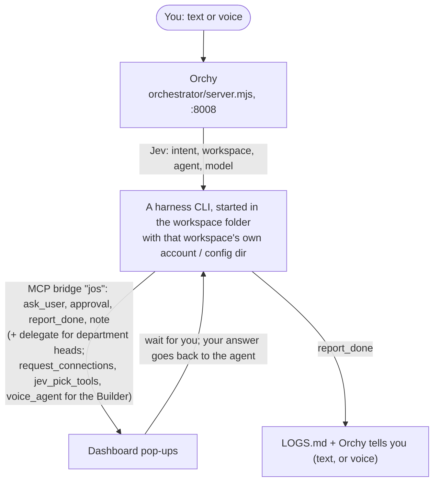

<div align="center">


# Orchy

**One chat box for all your AI agents: Orchy runs them on your own computer and asks you first.**

[](docs/LICENSE) [](https://nodejs.org) [](#supported-harnesses) [](docs/CONTRIBUTING.md)

[Quick start](#quick-start) · [How it works](#how-it-works) · [Harnesses](#supported-harnesses) · [Privacy](#what-leaves-your-machine) · [Docs](docs/)

</div>

---

Orchy is a local AI-agent orchestrator. You tell Orchy what you need, by text or voice. A small routing model (Jev, made by [TypeSafe](https://typesafe.ai), a separate company with no affiliation to Orchy) picks the workspace, the agent and the model. The work runs in that workspace, under that workspace's own account, using a coding-agent CLI (a "harness"). Orchy reports back and keeps a log of every finished task. It runs on your own machine, with a dashboard at http://localhost:8008.

**Why Orchy?** You keep one business or client per workspace, each with its own logins, so accounts never mix. Your agents use your real apps through [One](https://withone.ai), and Orchy stops for your OK before anything outward-facing: sending, posting, deleting, spending.

<p align="center">
  <picture>
    <source media="(prefers-color-scheme: dark)" srcset="assets/images/readme/live-night.png">
    
  </picture>
  <br>
  <sub>The Live view, with the dashboard's built-in sample data (<code>?open=live&amp;preview=live</code>). Nothing in it is real.</sub>
</p>

## If you are an AI agent setting this up or working in this repo: read this first

> [!IMPORTANT]
> This applies to Claude Code, Codex, OpenCode, Hermes, Antigravity and any other agent. Read this whole README before you change anything.
>
> - **Never mix accounts.** Each workspace runs under exactly one login per harness (`claudeAccount`, `codexAccount` and so on in `orchestrator/config.json`). `accountCheck` in `orchestrator/lib/workspaces.mjs` checks it before every run. Do not weaken it.
> - **One login per workspace.** Each workspace has its own One login (`one init --auth browser --project`, run inside that workspace folder). Never run a `one` action for one workspace from another workspace's folder. A workspace without its own login must not run `one`.
> - **Workspaces live in `workspaces/`** (git-ignored). Each has its own CLAUDE.md / AGENTS.md. Read the one in the workspace you work in.
> - **Do not weaken the safety files:** `orchestrator/lib/policy.mjs`, `orchestrator/lib/gate.mjs`, the cross-site / Host / Origin check in `orchestrator/server.mjs`, the paired-browser check (`orchestrator/lib/owner.mjs`, and `ownerOnly` and `FILE_READS` in `orchestrator/server.mjs`), the artifact path guard (`resolveFile` in `orchestrator/lib/artifacts.mjs`), the automatic retry gate (`retryGate` in `orchestrator/lib/recover.mjs`), the Cloudflare refusals and the Access token check in `orchestrator/portal.mjs` and `orchestrator/lib/cfaccess.mjs`, and the client sandbox (`orchestrator/lib/clientspace.mjs`, `orchestrator/lib/clients.mjs`).
> - **Never commit secrets or machine state:** `.env`, `orchestrator/config.json`, `orchestrator/voice-agents.json`, `orchestrator/data/`.
> - **The dashboard API has no password login.** It only answers its own origin on 127.0.0.1, and changes are only taken from a browser the owner paired. Keep it that way. Never bind it to another interface or put it behind a tunnel.
> - **Ask the owner before anything outward-facing:** sending, posting, deleting, charging, sharing.
> - **One task, one folder.** Files a task makes go in their own folder under the `Tasks/` of the agent's home (`<Department>/<call name>/Tasks/`), or the workspace's `Tasks/` in a workspace without departments.

## ✨ Highlights

- 💬 **Text or voice.** Type a task, or talk to Orchy and call your agents. Voice is optional and off until you switch it on (ElevenLabs or Deepgram).
- 🧭 **Smart routing, optional.** Jev picks the workspace, agent and model, and shows you its pick first. Without it, Orchy matches each message by its words.
- 🧰 **Bring your own harness.** Claude Code, Codex, OpenCode, Hermes or Antigravity, each signed in with the workspace's own account.
- 🔌 **Your real apps.** Gmail, Slack, Notion, Stripe and 750+ more through the [One CLI](https://withone.ai).
- ✋ **Asks before it acts.** Money, sending, calendar changes, deleting and sharing wait for your OK in the dashboard.
- 🗂️ **Workspaces that never mix.** One folder per business or client, with its own logins, agents and instructions.
- 🤝 **Huddles and missions.** Agents talk a task through together, or hand work along a chain of steps.
- 📺 **Live view and file viewer.** Watch every run step by step and open what it made, right in the dashboard.
- 🏠 **Local only.** The dashboard listens on 127.0.0.1 and takes changes only from a browser you paired.

## 📖 Contents

- [Quick start](#quick-start)
- [How it works](#how-it-works)
- [What leaves your machine](#what-leaves-your-machine)
- [Security](#security)
- [First run](#first-run)
- [Getting started with One](#getting-started-with-one)
- [Core ideas](#core-ideas)
- [Supported harnesses](#supported-harnesses)
- [Troubleshooting](#troubleshooting)
- [Project structure](#project-structure)
- [Contributing](#contributing)
- [License](#license)

## Quick start

```bash
git clone https://github.com/janmm97/orchy-ai
cd orchy-ai
npm run setup
```

That's it. Setup checks your tools, asks three questions, starts Orchy and opens the dashboard in your browser.

**Rather not use a terminal?** Open the `launchers` folder and double-click the one for your computer: `Start Orchy.cmd` (Windows), `Start Orchy.command` (macOS) or `Start Orchy.sh` (Linux). It runs setup too. Setup also puts that launcher in the Orchy folder, so from then on you double-click it to start Orchy.

<details>
<summary><b>What setup asks</b></summary>

1. **Voice?** Talk to Orchy and call your agents. If yes, pick the service you have (ElevenLabs, Deepgram or both) and paste its key. If no, Orchy is chat only. Settings → Voice turns it on later.
2. **Jev?** The routing model that picks the workspace, agent and model for each message. If yes, use a TypeSafe key, or another provider: OpenRouter, OpenCode Zen or Vercel AI Gateway. If no, Orchy matches each message by its words and the agent picks its own tools. Settings → "Use Jev?" changes it later.
3. **Scripts?** Let agents run scripts on their own unless a script looks like a decision (recommended), or ask before every script.

Each key is checked once with its service and saved in `.env` on your PC. Keys are hidden as you type. Then Orchy starts and your browser opens the dashboard, where the setup guide walks you through adding a workspace, connecting apps and making your first agent. Run `npm run setup` again any time to change your answers, and `npm start` to start Orchy after that.

</details>

### Prerequisites

- Node.js 20 or newer.
- Git, to clone the repository. The repository is private for now: the owner invites you on GitHub, and the first clone asks you to sign in.
- At least one harness CLI installed and signed in. Claude Code is recommended (see [Supported harnesses](#supported-harnesses)).
- The One CLI (`one`), so agents can use your apps. Setup offers to install it. See [docs/ONE.md](docs/ONE.md).
- Optional: ffmpeg (with ffprobe), for thumbnails, video posters and playable copies in the file viewer. Without it every file still opens as is. Orchy finds it on your PATH, in the usual install folders (Homebrew, winget), or at `FFMPEG_PATH` in `.env`.

### Keys

`npm run setup` asks for these. You can also put them in `.env` (see `.env.example`) or in Settings in the dashboard. **All of them are optional.**

| Key | What it unlocks | Without it |
|---|---|---|
| `TYPESAFE_API_KEY` | Jev from TypeSafe, the native model | Another Jev provider if one is set, else your agent harness reads each message (slower), else keyword matching |
| `OPENROUTER_API_KEY` | Jev through OpenRouter, as `~typesafe/jev-latest` (a chat model answering Jev's questions) | As above |
| `AI_GATEWAY_API_KEY` | Jev through Vercel AI Gateway, as `typesafe-ai/jev` (native) | As above |
| `OPENCODE_API_KEY` | Jev through OpenCode Zen, as `jev-1.13` (a chat model). OpenCode's free tier only works inside the OpenCode app | As above |
| `ELEVENLABS_API_KEY` | Orchy's spoken replies and voice calls with agents | The browser's voice |
| `DEEPGRAM_API_KEY` | A backup voice for Orchy's spoken replies | The browser's voice |

`JEV_PROVIDER` picks one provider when several keys are set (`typesafe`, `openrouter`, `vercel`, `opencode`, or `off`). With Jev off, the harness you installed stands in: it answers Jev's routing questions (10 to 30 seconds a message, on that harness's own sign-in), and keyword matching is the last resort. The same harness answers when you talk to Orchy if Claude Code isn't installed: Codex, OpenCode or Hermes, without tools (it can't open files you attach; Claude Code can). `ORCHY_BRAIN` picks one (`claude`, `codex`, `opencode`, `hermes`) or `off`. `VOICE_ENABLED=0` switches voice off: nothing speaks, nothing rings, and nothing goes to ElevenLabs or Deepgram.

## How it works



<details>
<summary>The same flow as plain text</summary>

```
You --text/voice--> Orchy (orchestrator/server.mjs, :8008)
                     | Jev: intent, workspace, agent, model
                     v
        a harness CLI, started in the workspace folder
        with that workspace's own account / config dir
                     | MCP bridge "jos": ask_user, approval, report_done, note
                     |   (+ delegate for department heads;
                     |    request_connections, jev_pick_tools, voice_agent for the Builder)
                     v
        dashboard pop-ups <-- wait for you --> your answer goes back to the agent
                     |
        report_done --> LOGS.md + Orchy tells you (text, or voice)
```

</details>

Type a task on the home screen. Jev shows a routing card (workspace, agent, model) and sends it after a short countdown, or waits for you when it is unsure.

<p align="center">
  <picture>
    <source media="(prefers-color-scheme: dark)" srcset="assets/images/readme/routing-night.png">
    
  </picture>
  <br>
  <sub>A routing card, from the dashboard's sample data (<code>?preview=route</code>).</sub>
</p>

## What leaves your machine

Orchy runs on your PC, but these services see some of your data when you use them:

- **The Jev provider** (TypeSafe, OpenRouter, Vercel AI Gateway or OpenCode Zen): each instruction you type, plus the names and descriptions of your workspaces and agents, so Jev can route it. Without a Jev key, routing stays on your PC.
- **Your harness** (Claude Code, Codex and so on): everything the agent works on, under that workspace's own account, as it would if you ran the harness yourself.
- **One**: the app actions your agents run, under that workspace's One login.
- **ElevenLabs** (only with voice on): your agents' names, roles and instructions (each gets a voice agent), what Orchy says aloud, and the audio of voice calls.
- **Deepgram** (only with voice on): what Orchy says aloud, when it is the voice in use.
- **Cloudflare**: client pages, if you put them online.

**Orchy does not send anything to its authors.**

## Security

- **Local only.** The dashboard answers only its own origin on 127.0.0.1. It has no password login, so it must never be bound to another interface or put behind a tunnel, and it refuses Cloudflare traffic.
- **Paired browsers.** Only a paired browser can make changes in Orchy (send tasks, answer approvals, change settings). See Pairing under [First run](#first-run).
- **An approval gate on every harness.** Agents do routine work alone and stop for decisions: money, sending, calendar changes, deleting, sharing. The full rules are under [Approval gate and policy](docs/CONCEPTS.md#approval-gate-and-policy).
- **Accounts never mix.** Every run is checked against the workspace's own harness login before it starts, and each workspace has its own One login.
- **Ungated harnesses are refused by default.** See [Supported harnesses](#supported-harnesses).

Report security problems privately: see [SECURITY.md](docs/SECURITY.md).

## First run

The dashboard's setup guide has seven steps:

1. **You.** Tell Orchy your name and time zone.
2. **Tools.** Orchy checks that Node, a harness CLI and the One CLI are installed.
3. **Keys.** Add the optional [keys](#keys), or skip them.
4. **First workspace.** Workspace, then Add. Name it, say what it is for, pick its harness and account. Orchy creates the folder under `workspaces/`.
5. **Sign in to One.** Workspace, open the workspace, "Sign in to One". See [docs/ONE.md](docs/ONE.md).
6. **First app.** Connections, the workspace, "Add app".
7. **First agent.** Ask the AI Agent Builder for an agent and choose which apps it gets.

**Pairing.** Only a paired browser can make changes in Orchy (send tasks, answer approvals, change settings). Orchy pairs the browser it opens for you. Another browser shows a "Pair this browser" window: type the code from the terminal where Orchy is running, or make one on a paired browser in Settings → This browser. This keeps the agents running on your PC from making changes in your name.

Then type a task on the home screen.

<p align="center">
  <picture>
    <source media="(prefers-color-scheme: dark)" srcset="assets/images/readme/home-night.png">
    
  </picture>
  <br>
  <sub>The home screen on a fresh install.</sub>
</p>

## Getting started with One

Orchy works with [One](https://withone.ai).

One connects agents to third-party apps. Orchy uses its CLI for every app connection. The short version is in [docs/ONE.md](docs/ONE.md). The same text is shown in the terminal and the dashboard.

1. Create a One account at https://app.withone.ai/sign-in.
2. Use one One organization per business or client. The organization switcher is at the top left of the One dashboard.
3. In Orchy: Workspace, open the workspace, "Sign in to One". It runs `one init --auth browser --project` in that workspace folder. Choose the organization this workspace should use when One asks. The login is saved for that folder only.
4. Connected apps are listed on the "Connected Apps" page in the One dashboard (left sidebar). "Add new app" connects one.
5. In Orchy: Connections, the workspace, "Add app". It runs `one connection add <app>` and opens the app's sign-in page.
6. If an app is not available, switch it on in the One dashboard: Developers (bottom left), "Embeddable Auth" tab, search the tool, turn on "Visible". Full steps are in [docs/ONE.md](docs/ONE.md).
7. The AI Agent Builder asks which connections each agent gets, Read or Full. Changes to agents need your approval.

## Core ideas

The short version. Every detail is in **[docs/CONCEPTS.md](docs/CONCEPTS.md)**.

| | Idea | In one line |
|---|---|---|
| 🗂️ | [Workspaces](docs/CONCEPTS.md#workspaces) | A folder in `workspaces/` for one business or client, with its own harness account, One login, agents and CLAUDE.md / AGENTS.md. Shown as "Acme Workspace". |
| 🏢 | [Departments, agent homes and Resources](docs/CONCEPTS.md#departments-agent-homes-and-resources) | A workspace is laid out like a company: department folders, one home per agent with its `Tasks/`, and `Resources/` for every skill, MCP server copy and CLI note. |
| 🤖 | [Agents](docs/CONCEPTS.md#agents) | A Markdown file (`.claude/agents/<name>.md`) with a name, a role, instructions and the apps it may use. |
| 🛠️ | [AI Agent Builder](docs/CONCEPTS.md#ai-agent-builder) | Every workspace has one. It researches the role, writes new agents and asks which connections each gets. Changes need your approval. |
| 🔑 | [MCP sign-in](docs/CONCEPTS.md#mcp-sign-in) | Remote MCP servers that sign in with an account get a Sign in button; the token stays in Orchy's data folder, never in a workspace. |
| 👥 | [Department heads and delegation](docs/CONCEPTS.md#department-heads-and-delegation) | An agent with a `team:` list hands parts of a task to its team, one level deep, at most three at once. |
| 🤝 | [Huddles](docs/CONCEPTS.md#huddles) | Two or more agents talk a task through and push back on each other. Nothing is built until you approve their agreement. |
| 🧩 | [Missions](docs/CONCEPTS.md#missions) | One ask that needs several agents in a row, planned as 2 to 6 steps you can change, swap or drop before it starts. |
| ✋ | [Approval gate and policy](docs/CONCEPTS.md#approval-gate-and-policy) | Every harness approval request goes through `gate.mjs` and `policy.mjs`: routine work runs, decisions wait for you. |
| ⏳ | [Run queue and usage limits](docs/CONCEPTS.md#run-queue-and-usage-limits) | At most three agents per account at once by default; a run that hits a usage limit pauses and resumes by itself. |
| 📡 | [Live run events](docs/CONCEPTS.md#live-run-events) | Every step is streamed to the dashboard and kept on disk, with secrets blanked first. |
| 💲 | [Usage and cost](docs/CONCEPTS.md#usage-and-cost) | Tokens and cost per run, and a weekly review that suggests savings. |
| 📁 | [Artifacts](docs/CONCEPTS.md#artifacts) | Every file an agent writes is registered, so you can open it in the dashboard. |
| ✅ | [Orchy checks the result](docs/CONCEPTS.md#orchy-checks-the-result) | Before reporting, Orchy checks that "done" holds up. It flags, never re-runs on its own. |
| 🔁 | [Recovery](docs/CONCEPTS.md#recovery) | Failed runs say why. Read-only runs that failed on the engine or network retry by themselves; anything else asks you. |
| 📺 | [Live view](docs/CONCEPTS.md#live-view) | LIVE in the top bar: Activity, Work and Output columns. On a phone they become tabs. |
| 🖼️ | [File viewer](docs/CONCEPTS.md#file-viewer) | One viewer for images, video, audio, PDFs, Markdown, code, tables, Word and slides. |
| 🪟 | [One window at a time](docs/CONCEPTS.md#one-window-at-a-time) | Opening a page or an item takes the place of the one that's up. Decisions are never swapped away. |
| 🕘 | [Scheduling](docs/CONCEPTS.md#scheduling) | `schedule: weekdays 9:00` in an agent's frontmatter runs it by itself while Orchy is running. |
| 🧵 | [Sessions](docs/CONCEPTS.md#sessions) | Each conversation with Orchy has its own thread, memory and runs. |
| 🌐 | [Client pages](#client-pages) | Share chosen agents with a client on their own page and sandbox. |
| 🔧 | [Orchy fixing itself](docs/CONCEPTS.md#orchy-fixing-itself) | Tell Orchy what is broken; a "Fix Orchy" card always waits for your OK, and the report has an Undo. |

### Client pages

Client pages are optional. You can share chosen agents with a client on their own page (second server, port 8009, `/c/<link>` only). Clients work in their own sandbox, approve app decisions, and never see the rest of Orchy. Anything touching your machine still asks you.

<details>
<summary><b>Putting client pages online</b> (Cloudflare Tunnel + Access, and R2 for video)</summary>

To put it online, use a Cloudflare Tunnel plus Cloudflare Access, and give Orchy the Access team and the application's AUD tag (Workspaces → Client access, or `CF_ACCESS_TEAM_DOMAIN` and `CF_ACCESS_AUD` in `.env`): Orchy checks the token Cloudflare signs on every visit, and keeps the page closed online until both are set. Other tunnels are refused. **Never tunnel port 8008: the dashboard refuses Cloudflare traffic.**

Clients open the files their own tasks made in the same viewer as your dashboard (images, PDFs, documents, tables, web pages), and only those. Video and audio never go through the tunnel (Cloudflare's terms): they play from a private Cloudflare R2 bucket through links that last 15 minutes at most. To switch that on, turn on R2 in Cloudflare, make a private bucket with a lifecycle rule that deletes objects after 30 days and an R2 API token with Object Read & Write for that bucket only, then put `R2_ACCOUNT_ID`, `R2_ACCESS_KEY_ID`, `R2_SECRET_ACCESS_KEY` and `R2_BUCKET` in `.env` (no restart needed, no CORS rule needed). Without them clients see a video's poster and "Video playback isn't switched on yet".

</details>

<p align="center">
  
  <br>
  <sub>The Live view on a phone, with the dashboard's sample data.</sub>
</p>

## Supported harnesses

| Harness | Install | Gated? |
|---|---|---|
| **Claude Code** (recommended) | `curl -fsSL https://claude.ai/install.sh \| bash`; Windows (PowerShell): `irm https://claude.ai/install.ps1 \| iex` | ✅ yes |
| **Codex** | `curl -fsSL https://chatgpt.com/codex/install.sh \| sh`; Windows: `powershell -ExecutionPolicy ByPass -c "irm https://chatgpt.com/codex/install.ps1 \| iex"` | ✅ yes |
| **OpenCode** | `curl -fsSL https://opencode.ai/install \| bash`; on Windows `npm install -g opencode-ai` | ✅ yes |
| **Hermes** | `curl -fsSL https://hermes-agent.nousresearch.com/install.sh \| bash`; on Windows (PowerShell) `iex (irm https://hermes-agent.nousresearch.com/install.ps1)` | ✅ yes |
| **Antigravity** (off by default) | Google's `agy` CLI (see antigravity.google), then `ORCHY_ANTIGRAVITY=1` in `.env` | ⚠️ no: refused unless the workspace allows it |

"Gated" means every risky action asks Orchy first. You don't have to type these: **Install** in the dashboard (Add workspace, or Set up Orchy → Tools) runs the right one for your computer in a terminal window, then the sign-in. The full status of each harness, including what has been tested, is below.

<!-- HARNESS-STATUS:START -->
| Harness | Install command | How Orchy gates its approvals | Status |
|---|---|---|---|
| Claude Code | `curl -fsSL https://claude.ai/install.sh \| bash`; Windows: `irm https://claude.ai/install.ps1 \| iex` | MCP permission tool `mcp__jos__approval` | gated: yes. Pending real-install test (see docs/HARNESSES.md) |
| Codex | `curl -fsSL https://chatgpt.com/codex/install.sh \| sh`; Windows: `powershell -ExecutionPolicy ByPass -c "irm https://chatgpt.com/codex/install.ps1 \| iex"` | `codex app-server`, policy `untrusted`, every request to the gate | gated: yes. Pending real-install test (see docs/HARNESSES.md) |
| OpenCode | `curl -fsSL https://opencode.ai/install \| bash`; Windows: `npm install -g opencode-ai` | `opencode serve`, every tool set to `ask`, answered through its permissions endpoint | gated: yes. Implemented, unverified against the real binary (see docs/HARNESSES.md) |
| Hermes | `curl -fsSL https://hermes-agent.nousresearch.com/install.sh \| bash`; Windows (PowerShell): `iex (irm https://hermes-agent.nousresearch.com/install.ps1)` | `hermes acp` over ACP, plus Orchy's `pre_tool_call` hook (fail closed) in its profile: every tool call asks the gate first | gated: yes. Checked against the real binary (Hermes 0.21.7, Windows; see docs/HARNESSES.md) |
| Antigravity | Google's `agy` CLI (see antigravity.google); off until `ORCHY_ANTIGRAVITY=1` in `.env` | `agy -p` with stream-json; it can't ask mid-run, so you approve each whole run first, then it runs inside deny rules Orchy writes (`--gemini_dir`) | gated: NO (commands aren't checked). Implemented, unverified against the real binary in this repo; off by default, refused unless the workspace sets `allowUngated` and has its own One login (see docs/HARNESSES.md) |
<!-- HARNESS-STATUS:END -->

Every harness that can't hold every action behind the gate (gated: NO) also needs the workspace's own One login: Orchy can't see all of its commands, so it could otherwise reach another account's apps.

<details>
<summary><b>Which instructions an agent run reads</b></summary>

Agent runs read only the workspace's own instructions, never the CLAUDE.md / AGENTS.md at the root of this repo (they are for coding agents working on Orchy): Claude Code runs exclude them (`claudeMdExcludes`), Codex starts with `project_root_markers=[]` so it reads AGENTS.md only in the workspace folder, and OpenCode stops at the first AGENTS.md (or CLAUDE.md) it finds walking up, the workspace's own (keep one in every workspace; new ones get both), and doesn't read your personal `~/.claude/CLAUDE.md`. Hermes and Antigravity are unverified on this point (docs/HARNESSES.md).

</details>

Ori Harness (`ori`) is a launcher, not a harness, and is not supported yet. Details, headless commands, config locations, the evidence behind each "gated" answer and manual verification checklists are in [docs/HARNESSES.md](docs/HARNESSES.md).

**Platforms:** Windows, macOS and Linux. Windows is the most tested; on macOS and Linux, report what breaks.

## Troubleshooting

```bash
npm run check
```

This health check tests each workspace's accounts, the One CLI, Jev, voice, agents and client pages, and says what to fix. Do not remove the check.

| Problem | What to do |
|---|---|
| Orchy will not start | Read the error in the terminal window it was started from. After Orchy restarted himself, it is in `orchestrator/data/server.err.log`. |
| The dashboard says it can't make changes | The browser isn't paired: see Pairing under [First run](#first-run). |
| A workspace says it is not signed in to One | Workspaces, the workspace, "Sign in to One". |
| A run is refused for an account mismatch | The harness profile for that workspace is logged into the wrong account: sign in again with the right one. |

## Project structure

```
orchy-ai/
├── orchestrator/   the server (127.0.0.1:8008), client pages (:8009), the gate, harness adapters, scripts
├── dashboard/      the UI: plain ES modules, no build step
├── scripts/        setup.mjs (npm run setup)
├── launchers/      double-click launchers for Windows, macOS and Linux
├── docs/           ONE.md, HARNESSES.md, CONCEPTS.md, SECURITY.md, CONTRIBUTING.md, LICENSE, NOTICE
├── assets/         the logo and README images
└── workspaces/     your workspaces (git-ignored)
```

<details>
<summary><b>Where the code lives (full file map)</b></summary>

| Path | What it is |
|---|---|
| `orchestrator/server.mjs` | HTTP and SSE API on 127.0.0.1:8008, origin checks, hot-reloaded `.env` |
| `orchestrator/portal.mjs` | Client pages server (port 8009) |
| `orchestrator/lib/router.mjs`, `jev.mjs`, `livejev.mjs` | Jev routing, live reading as you type |
| `orchestrator/lib/runner.mjs`, `claude.mjs`, `codex.mjs` | Starting runs on each harness, the per-account queue, usage-limit pauses |
| `orchestrator/lib/engines/` | One adapter per harness (`index.mjs` is the registry: capabilities, opt-in engines); `antigravity.mjs` is Google's agy CLI (off by default, every run approved first) |
| `orchestrator/lib/bus.mjs`, `activity.mjs` | The replayable event stream; what each run is doing, redaction, safe step summaries |
| `orchestrator/lib/logs.mjs`, `usagereview.mjs` | LOGS.md, usage and cost, the weekly usage review |
| `orchestrator/lib/artifacts.mjs`, `media.mjs` | The file registry and its path guard, previews (Office, CSV, JSON), research sources; ffmpeg thumbnails, posters and playable copies |
| `orchestrator/lib/validate.mjs`, `recover.mjs` | Orchy's check of a finished run; failure classes, the safe automatic retry, recovery cards, stuck runs |
| `orchestrator/mcp/cwd-hook.mjs` | Tells the gate where each Claude Code shell command runs |
| `orchestrator/lib/gate.mjs`, `policy.mjs` | Approval gate and rules |
| `orchestrator/lib/owner.mjs` | Paired browsers: only they can make changes |
| `orchestrator/lib/cfaccess.mjs` | Cloudflare Access token check for client pages |
| `orchestrator/lib/workspaces.mjs`, `scaffold.mjs` | Workspaces, accounts, One scope, "<Name> Workspace" names; what a new workspace starts with |
| `orchestrator/lib/agents.mjs`, `tasks.mjs`, `resources.mjs` | Agent files, departments and homes (`homeOf`, `departmentOf`); task folders (`taskRootFor`); `Resources/` (skills linked, MCP copies without secrets, INDEX.md, homes made) |
| `orchestrator/lib/mcpauth.mjs` | OAuth sign-in for remote MCP servers (tokens in `orchestrator/data/mcp-auth.json`) |
| `orchestrator/lib/delegation.mjs`, `huddle.mjs` | Department heads, huddles |
| `orchestrator/lib/huddlecoach.mjs`, `rules.mjs` | Orchy in huddles; your standing rules (what Orchy answers for you in a proposal) |
| `orchestrator/lib/missions.mjs` | Missions: the plan under the workspace's own account and its checks, the card, the step supervisor, the ceiling, restarts |
| `orchestrator/lib/scheduler.mjs`, `sessions.mjs` | Schedules, sessions |
| `orchestrator/lib/backend.mjs` | Orchy fixing himself, guarded files |
| `orchestrator/lib/clients.mjs`, `clientspace.mjs` | Client pages and sandbox |
| `orchestrator/lib/clientview.mjs`, `r2.mjs` | What a client's page may open (their own files only, scrubbed); client video through short-lived Cloudflare R2 links |
| `orchestrator/mcp/bridge.mjs` | MCP bridge given to each run |
| `orchestrator/templates/` | What new workspaces and the Builder start from |
| `orchestrator/scripts/` | `doctor.mjs` (npm run check), `organize.mjs` (lay an existing workspace out by department: plan, apply, rollback), test scripts |
| `dashboard/` | The UI, plain ES modules, no build step |
| `dashboard/js/windows.mjs` | Windows: one page and one item window at a time, Back, pop-outs |
| `dashboard/js/live.mjs`, `live/` | The Live view: `model.mjs` (state and derivations), `activity.mjs`, `work.mjs`, `output.mjs`, `fixtures.mjs` (`?preview=live` samples) |
| `dashboard/js/viewer.mjs`, `viewers/` | The file viewer; `media.mjs` (images, video, audio), `pdf.mjs` (pdf.js in `dashboard/vendor/pdfjs-6.3.289/`) |
| `dashboard/js/missions.mjs` | Mission cards and steps (draw nothing until the server sends missions) |
| `workspaces/` | Your workspaces (git-ignored) |
| `orchestrator/data/` | Runtime state and transcripts (git-ignored) |

</details>

## Contributing

PRs are welcome. See [CONTRIBUTING.md](docs/CONTRIBUTING.md). Run `npm test` first (no network, no keys and no harness needed), and keep personal data out. Report security problems privately: see [SECURITY.md](docs/SECURITY.md).

## License

Apache-2.0. See [LICENSE](docs/LICENSE) and [NOTICE](docs/NOTICE).

<div align="center">
<sub>Jev is made by <a href="https://typesafe.ai">TypeSafe</a>, a separate company with no affiliation to Orchy.</sub>
</div>
